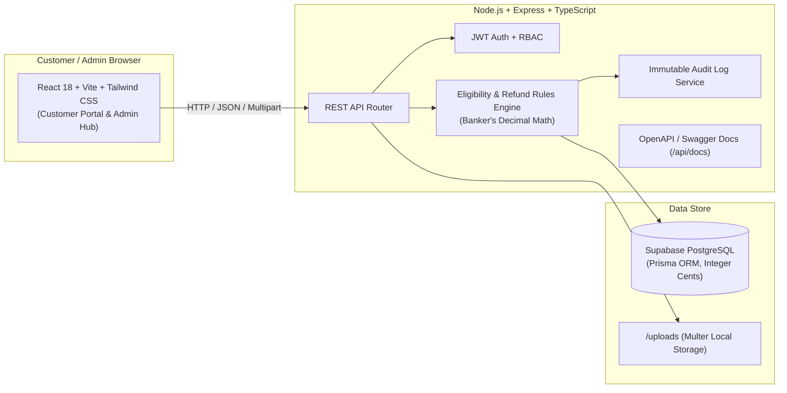

# 🔄 ReturnFlow – Return & Refund Management System

[](file:///.github/workflows/ci.yml)
[](https://nodejs.org/)
[](https://www.typescriptlang.org/)
[](https://supabase.com/)
[](https://react.dev/)
[](https://playwright.dev/)
[](https://jestjs.io/)
[](https://www.postman.com/)

> **A realistic, enterprise-grade e-commerce Return & Refund Management Platform and comprehensive Software Development Engineer in Test (SDET) QA Showcase.**
> Built to demonstrate mastery of manual test engineering, business rule testing, REST API validation, SQL ledger integrity, and multi-browser Playwright E2E automation with Page Object Model.

---

## 📑 Table of Contents
- [Architecture & Tech Stack](#-architecture--tech-stack)
- [Business Rules Engine (QA Test Oracle)](#-business-rules-engine-qa-test-oracle)
- [Pre-Seeded Edge Cases & Test Accounts](#-pre-seeded-edge-cases--test-accounts)
- [Intentional Defect Flag (`ENABLE_SEEDED_BUGS`)](#-intentional-defect-flag-enable_seeded_bugs)
- [5-Minute Quickstart](#-5-minute-quickstart)
- [QA Testing Artifacts & Verification Layers](#-qa-testing-artifacts--verification-layers)
  - [1. Unit & Integration Tests (Jest)](#1-unit--integration-tests-jest)
  - [2. Automated API Suite (Postman & Newman)](#2-automated-api-suite-postman--newman)
  - [3. Database & SQL Testing Suite](#3-database--sql-testing-suite)
  - [4. End-to-End Automation (Playwright)](#4-end-to-end-automation-playwright)
- [API Documentation (Swagger / OpenAPI)](#-api-documentation-swagger--openapi)
- [Resume & Interview QA Competency Guide](#-resume--interview-qa-competency-guide)

---

## 🏗 Architecture & Tech Stack



- **Backend:** Node.js, Express, TypeScript, Zod, Prisma ORM, Decimal.js (Banker's rounding), Multer, Winston/Morgan, Swagger UI.
- **Frontend:** React 18, TypeScript, Vite 5, Tailwind CSS, Lucide Icons, React Router DOM v6.
- **Database:** Supabase PostgreSQL (with offline SQLite fallback support).
- **QA & Testing:** Playwright (TypeScript POM), Jest + Supertest, Postman + Newman CLI, SQL Scripts, RTM, 88 Test Cases, 10 Seeded Bug Reports.

---

## ⚖ Business Rules Engine (QA Test Oracle)

ReturnFlow enforces rigorous e-commerce domain logic implemented in `backend/src/services/eligibilityService.ts` and `refundCalculator.ts`:

### 1. Eligibility Oracle
1. **Delivery Requirement:** Order status must be strictly `DELIVERED`. Orders in `PENDING`, `PROCESSING`, `SHIPPED`, or `CANCELLED` cannot initiate a return.
2. **30-Day Calendar Window:** Return window is exactly 30 days from delivery date (`delivery_date + 30 days`).
   - Day 30 is **strictly allowed**.
   - Day 31 is **strictly rejected**.
3. **Non-Returnable Items:** Items flagged `is_final_sale=true` or belonging to restricted categories (`GIFT_CARD`, `PERISHABLE`, `PERSONALIZED`) are permanently non-returnable.
4. **Quantity Ceiling & Duplicate Prevention:**
   $$\text{Available Quantity} = \text{Purchased Qty} - \sum \text{Active Return Quantities}$$
   - Active statuses: `SUBMITTED`, `UNDER_REVIEW`, `APPROVED`, `REFUND_INITIATED`, `REFUNDED`.
   - `CANCELLED` and `REJECTED` requests free up the quantity immediately.
5. **Reason Validation:**
   - Supported reasons: `DEFECTIVE`, `DAMAGED_IN_TRANSIT`, `WRONG_ITEM`, `NOT_AS_DESCRIBED`, `CHANGED_MIND`, `OTHER`.
   - Reason `OTHER` requires a customer comment of **at least 10 characters**.
   - Reasons `DEFECTIVE`, `DAMAGED_IN_TRANSIT`, and `WRONG_ITEM` **require at least one uploaded proof image** (`.jpg`, `.png`, or `.webp`, $\le 5\text{MB}$).

### 2. Refund Calculation Oracle
- All monetary values stored and calculated in **integer cents** to avoid IEEE-754 floating point precision drift.
- Banker's Rounding (`ROUND_HALF_EVEN`) applied to fractions of cents.
- **Formulas:**
  $$\text{Item Refund} = (\text{Unit Price} - \text{Prorated Discount per Unit}) \times \text{Quantity}$$
  $$\text{Tax Refund} = \frac{\text{Item Refund}}{\text{Order Subtotal} - \text{Order Discount}} \times \text{Order Tax}$$
  $$\text{Restocking Fee} = \begin{cases} 15\% \times \text{Item Refund} & \text{if Reason } \in \{\text{CHANGED\_MIND}, \text{NOT\_AS\_DESCRIBED}\} \\ 0 & \text{if Seller-Fault} \end{cases}$$
  $$\text{Shipping Refund} = \begin{cases} \text{Original Shipping Paid} & \text{if Entire Order Returned AND Reason is Seller-Fault} \\ 0 & \text{otherwise} \end{cases}$$
  $$\mathbf{\text{Total Refund}} = \mathbf{\text{Item Refund}} + \mathbf{\text{Tax Refund}} - \mathbf{\text{Restocking Fee}} + \mathbf{\text{Shipping Refund}}$$
- **Over-Refund Protection:** Total refund issued can never exceed original amount paid for the returned items.

### 3. State Machine Invariants
$$\text{SUBMITTED} \longrightarrow \text{UNDER\_REVIEW} \longrightarrow \text{APPROVED} \longrightarrow \text{REFUND\_INITIATED} \longrightarrow \text{REFUNDED}$$
$$\text{APPROVED} \longrightarrow \text{REFUND\_INITIATED} \longrightarrow \text{REFUND\_FAILED} \longrightarrow \text{REFUND\_INITIATED}$$
$$\text{SUBMITTED} \longrightarrow \text{CANCELLED} \quad (\text{Customer-only action before review})$$
$$\text{UNDER\_REVIEW} \longrightarrow \text{REJECTED} \quad (\text{Mandatory rejection reason required})$$

Invalid transitions throw `409 Conflict`. Terminal states (`REFUNDED`, `REJECTED`, `CANCELLED`) cannot transition further.

---

## 👥 Pre-Seeded Edge Cases & Test Accounts

The seed script (`backend/prisma/seed.ts`) populates 2 Admins, 5 Customers, 22 Products, 36 Edge-Case Orders, and 9 Status-Distributed Returns.

### Test Credentials
| Role | Email | Password | Test Data Profile / Edge Cases Owned |
| :--- | :--- | :--- | :--- |
| **Admin** | `admin1@returnflow.io` | `password123` | System Administrator with full triage, approval, rejection, and refund access. |
| **Admin** | `admin2@returnflow.io` | `password123` | Secondary Admin for multi-reviewer audit tracking. |
| **Customer** | `customer1@returnflow.io` | `password123` | **Alice Smith:** Has day-2 delivered order, day-30 boundary order, and multi-item discounted order. |
| **Customer** | `customer2@returnflow.io` | `password123` | **Bob Jones:** Has day-31 expired order, day-20 delivered order, and non-returnable perishable items. |
| **Customer** | `customer3@returnflow.io` | `password123` | **Charlie Brown:** Has GIFT_CARD and personalized engraved jewelry items. |
| **Customer** | `customer4@returnflow.io` | `password123` | **Diana Prince:** Has active `SUBMITTED`, `APPROVED`, and `REFUNDED` return requests. |
| **Customer** | `customer5@returnflow.io` | `password123` | **Evan Wright:** Has orders in `SHIPPED` and `PROCESSING` statuses (eligibility negative tests). |

> 💡 *Tip: The web frontend includes a convenient 1-click test credential switcher on the Login page!*

---

## 🐛 Intentional Defect Flag (`ENABLE_SEEDED_BUGS`)

ReturnFlow includes a toggleable defect injector designed for SDET candidate interviews and test suite demonstration. In `backend/.env`:

```env
ENABLE_SEEDED_BUGS=true
```

When set to `true`, 4 realistic defects are activated across the system:
1. **RF-BUG-001 (Boundary Off-by-One):** The 30-day window rejects Day 30 returns as expired.
2. **RF-BUG-002 (Accounting Defect):** Deducts 15% restocking fee even on `DEFECTIVE` items.
3. **RF-BUG-003 (Rounding Drift):** Uses standard floating-point division instead of Banker's Rounding for 3-way item splits.
4. **RF-BUG-004 (Security IDOR Defect):** Omits customer ownership check on `GET /returns/:id/images`.

*Run `npm test` in `backend` with `ENABLE_SEEDED_BUGS=false` for 100% passing baseline, and toggle to `true` to watch the QA test suite catch each defect!*

---

## ⚡ 5-Minute Quickstart

### Prerequisites
- Node.js 20.x or higher
- npm 10.x or higher

### Step 1: Clone and Configure Environment
```bash
git clone https://github.com/example/returnflow.git
cd returnflow
cp .env.example backend/.env
```

*(The `backend/.env` is pre-configured with Supabase PostgreSQL connection).*

### Step 2: Install Dependencies
```bash
# Backend dependencies
cd backend && npm install

# Frontend dependencies
cd ../frontend && npm install

# E2E test dependencies
cd ../e2e && npm install
```

### Step 3: Run Database Migrations & Seed
```bash
cd backend
npx prisma db push
npm run seed
```

### Step 4: Launch Applications
**Terminal 1 (Backend API):**
```bash
cd backend
npm run dev
# Running on http://localhost:3001 (API Docs at http://localhost:3001/api/docs)
```

**Terminal 2 (Frontend Client):**
```bash
cd frontend
npm run dev
# Running on http://localhost:5173
```

---

## 🧪 QA Testing Artifacts & Verification Layers

### 1. Unit & Integration Tests (Jest)
Located in [`backend/src/tests`](file:///c:/Users/hp/Desktop/RetrunFlow/backend/src/tests):
```bash
cd backend
npm test
```
- **6 Test Suites / 34 Tests:**
  - `eligibilityService.test.ts` (30-day boundary, delivered status check, non-returnable categories, quantity duplicate prevention)
  - `refundCalculator.test.ts` (prorated discounts, restocking fee waiver for seller-fault, shipping refund conditions, banker's rounding)
  - `seededBugs.test.ts` (explicit defect oracles verifying `ENABLE_SEEDED_BUGS` toggle)
  - `auth.test.ts` (registration, login, JWT issuance, password hashing, invalid credentials)
  - `returns.test.ts` (preview calculation, creation with proof image, customer cancellation, IDOR isolation)
  - `admin.test.ts` (review, approve, reject with reason, simulated payment gateway failure and retry)

### 2. Automated API Suite (Postman & Newman)
Located in [`qa/postman`](file:///c:/Users/hp/Desktop/RetrunFlow/qa/postman):
- `ReturnFlow.postman_collection.json` (17 requests covering complete customer & admin flows)
- `ReturnFlow.postman_environment.json` (dynamic token and ID storage)
- `run-newman.js` (CLI automated test runner script)

```bash
# Run API collection with Newman
cd qa/postman
node run-newman.js
```

### 3. Database & SQL Testing Suite
Located in [`qa/sql`](file:///c:/Users/hp/Desktop/RetrunFlow/qa/sql):
- [`01_data_integrity.sql`](file:///c:/Users/hp/Desktop/RetrunFlow/qa/sql/01_data_integrity.sql): Orphan checks, negative money amounts, refund caps.
- [`02_state_verification.sql`](file:///c:/Users/hp/Desktop/RetrunFlow/qa/sql/02_state_verification.sql): State machine invariant checks, audit trail presence, mandatory rejection reason checks.
- [`03_refund_reconciliation.sql`](file:///c:/Users/hp/Desktop/RetrunFlow/qa/sql/03_refund_reconciliation.sql): Mathematical reconciliation: Item + Tax - Restocking + Shipping = Total Refund.
- [`04_duplicate_detection.sql`](file:///c:/Users/hp/Desktop/RetrunFlow/qa/sql/04_duplicate_detection.sql): Active returned quantities vs purchased limits.
- [`05_constraint_tests.sql`](file:///c:/Users/hp/Desktop/RetrunFlow/qa/sql/05_constraint_tests.sql): DDL negative tests (Unique key, Check constraint, Foreign key cascade/restrict).

### 4. End-to-End Automation (Playwright)
Located in [`e2e`](file:///c:/Users/hp/Desktop/RetrunFlow/e2e):
- Page Object Model architecture (`pages/LoginPage.ts`, `pages/OrdersPage.ts`, `pages/ReturnFormPage.ts`, `pages/AdminPages.ts`, etc.)
- Reusable auth storage states (`fixtures/auth.setup.ts`)
- Interactive HTML test report with videos, traces, and screenshots on failure.

```bash
cd e2e

# Run all Playwright E2E tests
npx playwright test

# Run smoke suite only
npm run test:smoke

# Run regression suite only
npm run test:regression

# Open Playwright interactive HTML test report
npm run show-report
```

---

## 📖 API Documentation (Swagger / OpenAPI)

Interactive Swagger UI documentation is served automatically at:
- **Interactive UI:** `http://localhost:3001/api/docs`
- **Raw OpenAPI 3.0 YAML:** `http://localhost:3001/api/docs.json` or [`backend/src/swagger/openapi.yaml`](file:///c:/Users/hp/Desktop/RetrunFlow/backend/src/swagger/openapi.yaml)

---

## 💼 Resume & Interview QA Competency Guide

When showcasing ReturnFlow in SDET, QA Lead, or Full-Stack Engineer interviews, emphasize:

| QA Competency | Implementation & Artifact in ReturnFlow |
| :--- | :--- |
| **Test Planning & Strategy** | [`qa/test-plan.md`](file:///c:/Users/hp/Desktop/RetrunFlow/qa/test-plan.md): Complete IEEE 829-aligned test plan detailing scope, risks, entry/exit criteria, and defect lifecycle. |
| **Test Design Techniques** | [`qa/test-cases.csv`](file:///c:/Users/hp/Desktop/RetrunFlow/qa/test-cases.csv): 88 structured test cases utilizing Boundary Value Analysis (Day 30 vs Day 31), Equivalence Partitioning (reasons, file types), and State Transition Testing. |
| **Requirements Traceability** | [`qa/rtm.md`](file:///c:/Users/hp/Desktop/RetrunFlow/qa/rtm.md): Bidirectional matrix mapping 34 business requirements to test cases and automated scripts. |
| **Defect Reporting** | [`qa/bugs/`](file:///c:/Users/hp/Desktop/RetrunFlow/qa/bugs): 10 realistic bug reports with severity, priority, reproduction steps, root cause analysis, and suggested code fix. |
| **Database & SQL Auditing** | [`qa/sql/`](file:///c:/Users/hp/Desktop/RetrunFlow/qa/sql): Deep database assertions testing ledger reconciliation, orphan prevention, and state consistency. |
| **API Automation** | [`qa/postman/`](file:///c:/Users/hp/Desktop/RetrunFlow/qa/postman): Automated Newman runner with pre-request JWT scripts and Chai response validations. |
| **E2E Automation & POM** | [`e2e/`](file:///c:/Users/hp/Desktop/RetrunFlow/e2e): Multi-browser Playwright automation with Page Object Model, storage state reuse, and hybrid UI+API+DB verification. |
| **CI/CD Integration** | [`.github/workflows/ci.yml`](file:///.github/workflows/ci.yml): Multi-job pipeline running backend tests with coverage, frontend build, and Playwright execution with artifact publishing. |

---

## 📄 License
This project is open-source under the MIT License.

