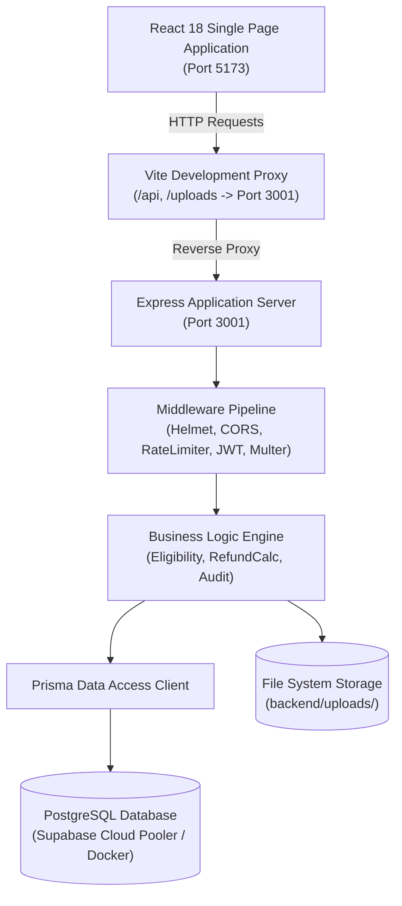
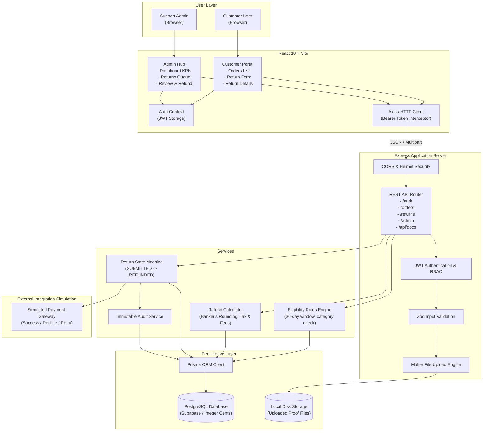
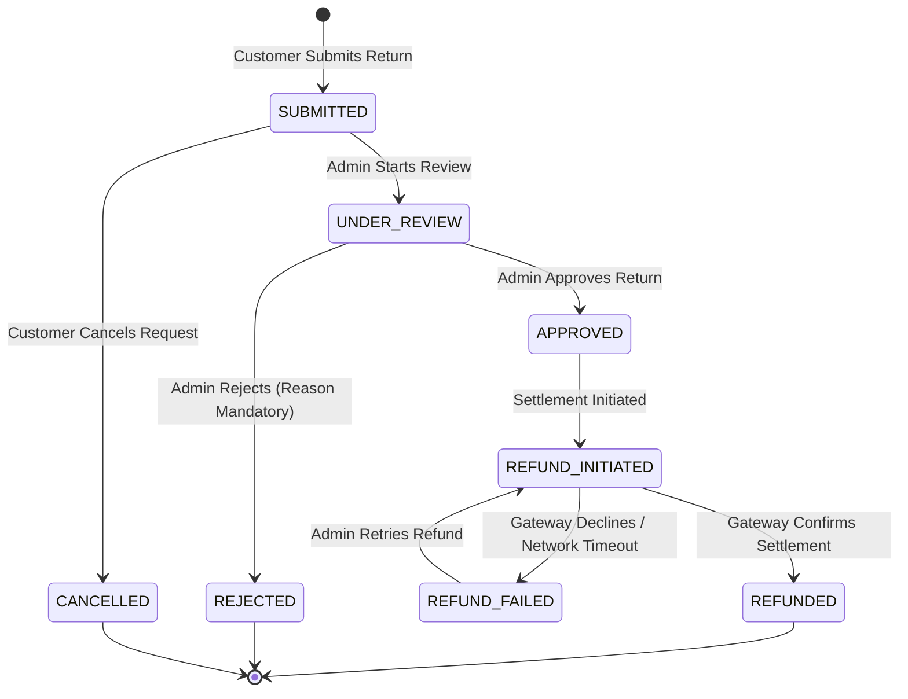
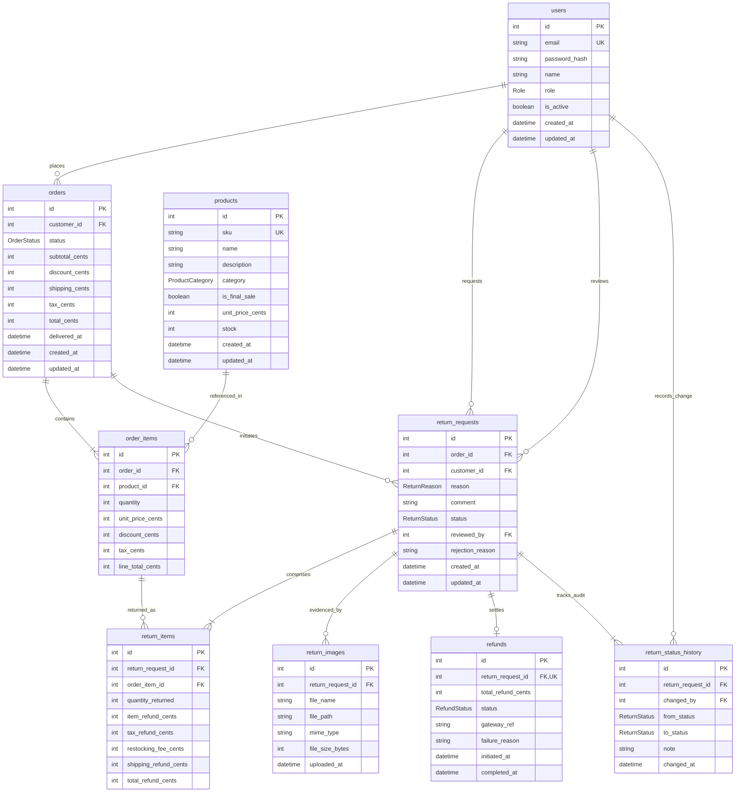
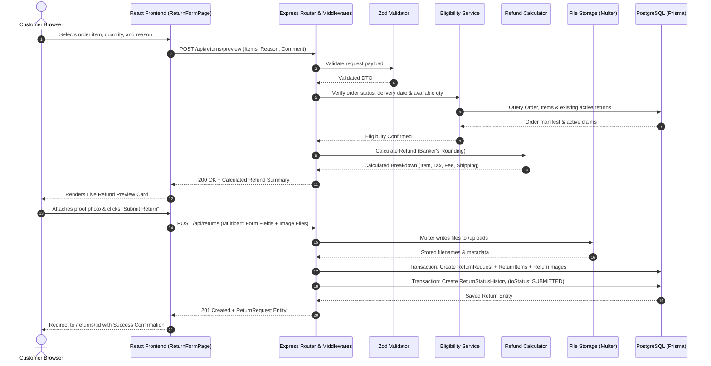
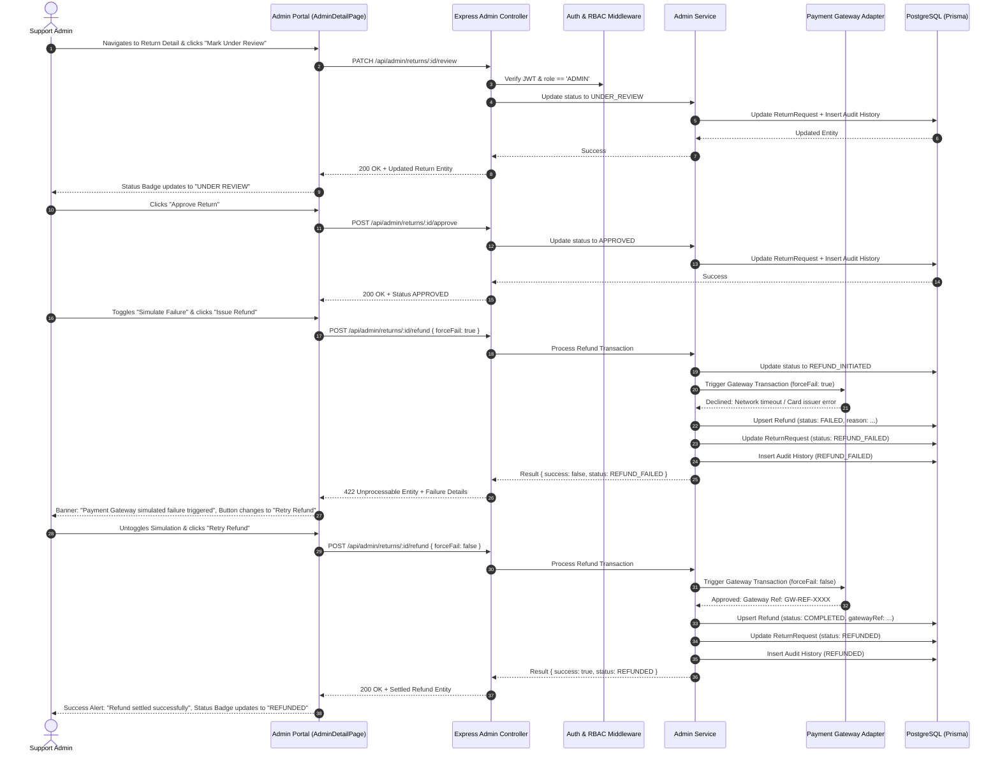

# ReturnFlow – System Architecture & Technical Design Documentation

> **Role & Document Context:**  
> Authored by Senior Software Architect & Technical Lead.  
> This document details the technology stack, system architecture, database design, domain rules, data flows, and codebase organization for **ReturnFlow**, an enterprise-grade e-commerce Return & Refund Management System.

---

## Table of Contents
1. [Project Overview](#1-project-overview)
   - [1.1 Purpose & Problem Statement](#11-purpose--problem-statement)
   - [1.2 Core Objectives](#12-core-objectives)
   - [1.3 Key Functional Capabilities](#13-key-functional-capabilities)
2. [Technology Stack](#2-technology-stack)
   - [2.1 Frontend Tier](#21-frontend-tier)
   - [2.2 Backend Tier](#22-backend-tier)
   - [2.3 Data Storage & ORM](#23-data-storage--orm)
   - [2.4 Quality Assurance & Test Engineering](#24-quality-assurance--test-engineering)
   - [2.5 DevOps & Infrastructure](#25-devops--infrastructure)
   - [2.6 Inter-Component Integration Map](#26-inter-component-integration-map)
3. [High-Level System Architecture](#3-high-level-system-architecture)
   - [3.1 Architecture Overview](#31-architecture-overview)
   - [3.2 High-Level Architecture Diagram](#32-high-level-architecture-diagram)
4. [Detailed Architecture & Component Design](#4-detailed-architecture--component-design)
   - [4.1 Architectural Pattern: Layered (N-Tier) & Hexagonal Modularization](#41-architectural-pattern-layered-n-tier--hexagonal-modularization)
   - [4.2 Presentation Layer (Client Application)](#42-presentation-layer-client-application)
   - [4.3 API Gateway & Routing Layer](#43-api-gateway--routing-layer)
   - [4.4 Middleware Pipeline](#44-middleware-pipeline)
   - [4.5 Domain Services Layer (Business Logic Engine)](#45-domain-services-layer-business-logic-engine)
     - [4.5.1 Eligibility Rules Engine](#451-eligibility-rules-engine)
     - [4.5.2 Financial Refund Engine & Banker's Rounding](#452-financial-refund-engine--bankers-rounding)
     - [4.5.3 Finite State Machine (Return Lifecycle)](#453-finite-state-machine-return-lifecycle)
     - [4.5.4 Audit Ledger & Traceability](#454-audit-ledger--traceability)
   - [4.6 Persistence & Data Access Layer](#46-persistence--data-access-layer)
5. [Database Architecture & Data Modeling](#5-database-architecture--data-modeling)
   - [5.1 Storage Engine & Conventions](#51-storage-engine--conventions)
   - [5.2 Entity-Relationship (ER) Diagram](#52-entity-relationship-er-diagram)
   - [5.3 Data Schema & Table Specifications](#53-data-schema--table-specifications)
   - [5.4 Database Enums](#54-database-enums)
   - [5.5 Indexing & Data Integrity Strategies](#55-indexing--data-integrity-strategies)
6. [Data Flow & Lifecycle Sequences](#6-data-flow--lifecycle-sequences)
   - [6.1 Return Request Submission & Live Calculation Flow](#61-return-request-submission--live-calculation-flow)
   - [6.2 Admin Approval & Payment Gateway Settlement Flow](#62-admin-approval--payment-gateway-settlement-flow)
7. [Repository & Codebase Structure](#7-repository--codebase-structure)
   - [7.1 Root Directory](#71-root-directory)
   - [7.2 Backend Directory Structure (`backend/`)](#72-backend-directory-structure-backend)
   - [7.3 Frontend Directory Structure (`frontend/`)](#73-frontend-directory-structure-frontend)
   - [7.4 E2E Test Suite Directory Structure (`e2e/`)](#74-e2e-test-suite-directory-structure-e2e)
   - [7.5 QA Artifacts Directory Structure (`qa/`)](#75-qa-artifacts-directory-structure-qa)

---

## 1. Project Overview

### 1.1 Purpose & Problem Statement
In modern e-commerce systems, reverse logistics (returns, exchanges, warranty claims, and refunds) represents one of the most operationally complex and error-prone domains. Standard e-commerce platforms frequently encounter:
- **Financial Leaks**: Double-refunding, rounding inaccuracies caused by standard IEEE-754 floating-point arithmetic, and failure to account for prorated discounts, restocking fees, and shipping policies.
- **Fraud & Over-Claiming**: Customers claiming refunds on quantities exceeding what was purchased, returns submitted outside the return window, or returning non-returnable categories (e.g., gift cards, perishables, final sale goods).
- **Audit Deficits**: Unclear audit trails regarding who approved a return, why an item was rejected, or whether gateway settlements succeeded.

**ReturnFlow** is engineered as an enterprise-grade, full-stack Return & Refund Management Platform designed to enforce strict domain invariants, mathematical accuracy, role-based access control, and complete audit traceability.

### 1.2 Core Objectives
1. **Mathematical Accuracy**: All financial transactions, calculations, and ledgers operate in **integer cents** with strict **Banker's Rounding (Round-Half-Even)** to eliminate cumulative precision errors.
2. **Deterministic Domain Rules**: A central business rule oracle rigorously validates delivery windows, product category restrictions, proof-of-damage requirements, and remaining returnable quantities.
3. **Audited Finite State Machine**: Return requests follow an immutable lifecycle with strict status transitions and record every state alteration in a persistent audit ledger.
4. **Comprehensive Test Engineering**: Provides a dual verification harness with unit tests, integration tests, Postman/Newman API suites, and multi-browser Playwright End-to-End (E2E) automation following the Page Object Model (POM).

### 1.3 Key Functional Capabilities
- **Customer Portal**:
  - View historical orders with dynamic eligibility tags.
  - Interactive multi-item return request form with live refund preview.
  - Image upload support for photo evidence on damaged or defective items.
  - Real-time return tracking timeline with detailed cost breakdown and customer-initiated cancellation for pending requests.
- **Admin Review Queue**:
  - Centralized operations dashboard displaying real-time KPI metrics.
  - Multi-status filter tabs (All, Pending Review, Under Review, Approved, Refunded, Rejected, Cancelled, Failed Refund).
  - Inspection modal displaying photographic evidence, SKU details, and customer comments.
  - Workflow actions: Move to Under Review, Approve, Reject (with mandatory explanatory reason), and Issue/Retry Gateway Refund.
  - Simulated payment gateway failure switch to test gateway network drops and retries.
- **Developer & QA Tooling**:
  - Swagger UI / OpenAPI documentation hosted at `/api/docs`.
  - Intentional defect injection flag (`ENABLE_SEEDED_BUGS`) for QA training and penetration testing.
  - Database baseline reset and seed automation scripts.

---

## 2. Technology Stack

### 2.1 Frontend Tier
| Technology | Version | Location / Config | Architectural Purpose |
| :--- | :--- | :--- | :--- |
| **React** | `^18.2.0` | [`frontend/package.json`](file:///c:/Users/hp/Desktop/RetrunFlow/frontend/package.json) | Modern UI library utilizing functional components, custom hooks, and concurrent rendering. |
| **TypeScript** | `^5.2.2` | [`frontend/tsconfig.json`](file:///c:/Users/hp/Desktop/RetrunFlow/frontend/tsconfig.json) | Static typing for type safety across props, state, and API communication. |
| **Vite** | `^5.1.4` | [`frontend/vite.config.ts`](file:///c:/Users/hp/Desktop/RetrunFlow/frontend/vite.config.ts) | Next-generation bundler and local development server with Fast Refresh and proxy configuration. |
| **Tailwind CSS** | `^3.4.1` | [`frontend/tailwind.config.js`](file:///c:/Users/hp/Desktop/RetrunFlow/frontend/tailwind.config.js) | Utility-first CSS framework for responsive layout, accessibility, and modern styling. |
| **React Router DOM** | `^6.22.1` | [`frontend/src/App.tsx`](file:///c:/Users/hp/Desktop/RetrunFlow/frontend/src/App.tsx) | Client-side declarative routing, URL state management, and protected route guards (`ProtectedRoute`, `AdminRoute`). |
| **Axios** | `^1.6.7` | [`frontend/src/api/client.ts`](file:///c:/Users/hp/Desktop/RetrunFlow/frontend/src/api/client.ts) | Promise-based HTTP client equipped with request authorization interceptors and automated 401 token expiry handling. |
| **Lucide React** | `^0.344.0` | [`frontend/src/components/`](file:///c:/Users/hp/Desktop/RetrunFlow/frontend/src/components/) | Clean, lightweight icon suite for state badges, action triggers, and navigation cues. |

### 2.2 Backend Tier
| Technology | Version | Location / Config | Architectural Purpose |
| :--- | :--- | :--- | :--- |
| **Node.js** | `>=20.x` | Runtime Environment | Asynchronous non-blocking runtime powering the core application server. |
| **Express.js** | `^4.18.3` | [`backend/src/app.ts`](file:///c:/Users/hp/Desktop/RetrunFlow/backend/src/app.ts) | Minimalist web application framework providing RESTful routing, middleware composition, and lifecycle handling. |
| **TypeScript** | `^5.3.3` | [`backend/tsconfig.json`](file:///c:/Users/hp/Desktop/RetrunFlow/backend/tsconfig.json) | Strict static typing for domain models, DTOs, controllers, and service logic. |
| **Zod** | `^3.22.4` | [`backend/src/validators/`](file:///c:/Users/hp/Desktop/RetrunFlow/backend/src/validators/) | Schema declaration and validation library enforcing runtime request body and query constraints. |
| **Decimal.js** | `^10.4.3` | [`backend/src/services/refundCalculator.ts`](file:///c:/Users/hp/Desktop/RetrunFlow/backend/src/services/refundCalculator.ts) | Arbitrary-precision decimal library configured for Banker's Rounding (`ROUND_HALF_EVEN`). |
| **jsonwebtoken (JWT)**| `^9.0.2` | [`backend/src/services/authService.ts`](file:///c:/Users/hp/Desktop/RetrunFlow/backend/src/services/authService.ts) | Stateless authentication token generation and cryptographically signed verification. |
| **bcrypt** | `^5.1.1` | [`backend/src/services/authService.ts`](file:///c:/Users/hp/Desktop/RetrunFlow/backend/src/services/authService.ts) | Adaptive salted password hashing. |
| **Multer** | `^1.4.5-lts.1` | [`backend/src/services/fileService.ts`](file:///c:/Users/hp/Desktop/RetrunFlow/backend/src/services/fileService.ts) | Multipart/form-data handler with file size (5MB), count (max 5), and MIME type filtering. |
| **Helmet & CORS** | `^7.1.0` / `^2.8.5` | [`backend/src/app.ts`](file:///c:/Users/hp/Desktop/RetrunFlow/backend/src/app.ts) | HTTP header hardening, Cross-Origin Resource Policy, and origin white-listing. |
| **express-rate-limit**| `^7.2.0` | [`backend/src/middleware/rateLimiter.ts`](file:///c:/Users/hp/Desktop/RetrunFlow/backend/src/middleware/rateLimiter.ts) | DDoS and brute-force mitigation on authentication endpoints (`/login`, `/register`). |
| **Swagger UI Express**| `^5.0.0` | [`backend/src/swagger/openapi.yaml`](file:///c:/Users/hp/Desktop/RetrunFlow/backend/src/swagger/openapi.yaml) | Interactive OpenAPI 3.0 documentation server exposed at `/api/docs`. |

### 2.3 Data Storage & ORM
| Technology | Version / Provider | Location / Config | Architectural Purpose |
| :--- | :--- | :--- | :--- |
| **PostgreSQL** | `v15+` (Hosted on **Supabase**) | [`backend/.env`](file:///c:/Users/hp/Desktop/RetrunFlow/backend/.env) | Enterprise relational database providing ACID transactions, foreign key constraints, and relational queries. |
| **Prisma ORM** | `^5.10.0` | [`backend/prisma/schema.prisma`](file:///c:/Users/hp/Desktop/RetrunFlow/backend/prisma/schema.prisma) | Next-generation Object-Relational Mapper handling schema migrations, type-safe queries, and transactional guarantees. |
| **Local Disk Storage**| File System | `backend/uploads/` | Physical storage directory for customer-uploaded proof photos and inspection evidence. |

### 2.4 Quality Assurance & Test Engineering
| Framework / Tool | Location / Config | Architectural Purpose |
| :--- | :--- | :--- |
| **Playwright** | [`e2e/playwright.config.ts`](file:///c:/Users/hp/Desktop/RetrunFlow/e2e/playwright.config.ts) | Multi-browser End-to-End automation executing across Chromium with parallel execution controls, storageState fixtures, and Page Object Model. |
| **Jest & Supertest**| [`backend/tests/`](file:///c:/Users/hp/Desktop/RetrunFlow/backend/tests/) | Automated unit testing for business rules and integration testing for HTTP REST endpoints. |
| **Postman & Newman**| [`qa/postman/`](file:///c:/Users/hp/Desktop/RetrunFlow/qa/postman/) | Automated API regression collections executable via CLI in continuous integration. |
| **SQL Verification**| [`qa/sql/`](file:///c:/Users/hp/Desktop/RetrunFlow/qa/sql/) | Direct database sanity checks verifying ledger conservation and zero-sum invariants. |

### 2.5 DevOps & Infrastructure
- **Docker & Docker Compose**: Container configuration (`docker-compose.yml`) defining isolated services for PostgreSQL, Express backend, and React frontend.
- **GitHub Actions CI**: Automated pipeline in `.github/workflows/ci.yml` validating linting, unit tests, integration tests, and production builds.

### 2.6 Inter-Component Integration Map


---

## 3. High-Level System Architecture

### 3.1 Architecture Overview
ReturnFlow is designed around a decoupled, three-tier architecture:
1. **Presentation Tier**: A client-side Single Page Application (SPA) providing role-based customer and administrator experiences.
2. **Application / Logic Tier**: A stateless Express REST API encapsulating domain services, security policies, and calculation models.
3. **Data Tier**: A PostgreSQL relational database accessed through Prisma ORM, complemented by a persistent local storage volume for image attachments.

### 3.2 High-Level Architecture Diagram


---

## 4. Detailed Architecture & Component Design

### 4.1 Architectural Pattern: Layered (N-Tier) & Hexagonal Modularization
The backend follows a strict **Layered Architecture pattern** with unidirectional dependency flow:
```
Routes (Transport)  -->  Controllers (HTTP Adapter)  -->  Services (Domain Logic)  -->  Prisma / Database (Persistence)
```
- Controllers never execute database queries directly; they accept HTTP requests, delegate validation to Zod, call domain services, and format standardized responses.
- Services hold the core business invariants (such as eligibility checks, refund proration, and audit logging) and remain decoupled from Express HTTP objects (`req`, `res`).

### 4.2 Presentation Layer (Client Application)
Located in [`frontend/src/`](file:///c:/Users/hp/Desktop/RetrunFlow/frontend/src):
- **`App.tsx`**: Defines client routes wrapped by `<AuthProvider>`. Protects customer routes using `<ProtectedRoute>` and admin portals using `<AdminRoute>`.
- **`context/AuthContext.tsx`**: Manages user authentication state, token storage in `localStorage`, and provides login/logout helpers to consuming components.
- **`api/client.ts`**: Configures the shared Axios instance with interceptors for token injection and redirection on session expiration.
- **Pages**:
  - `OrdersPage.tsx`: Displays order histories with visual indicators (`✓ Eligible for return` or `Items no longer eligible`).
  - `ReturnFormPage.tsx`: Interactive multi-item selection form that queries `/returns/preview` on user input, displaying a live calculated refund card before submission.
  - `ReturnDetailPage.tsx`: Customer detail view featuring an action timeline and an instant cancellation trigger for `SUBMITTED` requests.
  - `admin/AdminDashboardPage.tsx`: Real-time KPI summaries (Total Returns, Pending Review, Under Review, Total Refunded).
  - `admin/AdminQueuePage.tsx`: Searchable, tabbed operations queue with status filtering.
  - `admin/AdminDetailPage.tsx`: Detailed operational view for approving, rejecting with notes, or settling refunds.

### 4.3 API Gateway & Routing Layer
Located in [`backend/src/routes/`](file:///c:/Users/hp/Desktop/RetrunFlow/backend/src/routes):
- **`authRoutes.ts`**: Endpoints for `/register`, `/login`, and `/me`.
- **`orderRoutes.ts`**: Endpoints for retrieving customer orders and individual order manifests.
- **`returnRoutes.ts`**: Customer-facing return endpoints:
  - `POST /returns/preview`: Non-destructive real-time preview of calculated refunds.
  - `POST /returns`: Multipart return request submission with file attachment upload.
  - `GET /returns`: Customer return history with pagination.
  - `GET /returns/:id`: Customer return detail with ownership validation.
  - `POST /returns/:id/cancel`: Early cancellation of pending requests.
- **`adminRoutes.ts`**: Protected operations endpoints restricted to `role === 'ADMIN'`:
  - `GET /admin/stats`: KPI metrics and status distribution.
  - `GET /admin/returns`: Filtered queue listing with search parameters.
  - `PATCH /admin/returns/:id/review`: Transition from `SUBMITTED` to `UNDER_REVIEW`.
  - `POST /admin/returns/:id/approve`: Transition from `UNDER_REVIEW` to `APPROVED`.
  - `POST /admin/returns/:id/reject`: Rejection transition requiring a validated reason.
  - `POST /admin/returns/:id/refund`: Settlement execution with simulated gateway failure support.
  - `GET /admin/returns/:id/history`: Audit trail inspection.

### 4.4 Middleware Pipeline
1. **Security & Protocol**: `helmet` sets secure HTTP headers; `cors` enforces allowed origins and credentials.
2. **Body Parsers**: Express JSON parser and URL-encoded parser transform inbound payloads.
3. **Static File Server**: Maps `/uploads` directly to the `backend/uploads/` directory with cross-origin resource policy permissions.
4. **Rate Limiting**: `rateLimiter.ts` limits registration and login attempts to 10 requests per 15-minute window per IP.
5. **Authentication (`authMiddleware.ts`)**:
   - `authenticate`: Extracts Bearer token, verifies cryptographic signature, and attaches decoded payload (`userId`, `role`) to `req.user`.
   - `requireAdmin`: Enforces `req.user.role === 'ADMIN'`, throwing `ForbiddenError` (403) on violation.
6. **Error Handling (`errorHandler.ts`)**: Centralized catch-all middleware transforming `AppError`, `ZodError`, `MulterError`, and unhandled exceptions into standardized JSON envelopes:
   ```json
   {
     "code": "VALIDATION_ERROR",
     "message": "Request payload validation failed",
     "details": [{ "field": "reason", "message": "Invalid return reason" }]
   }
   ```

### 4.5 Domain Services Layer (Business Logic Engine)

#### 4.5.1 Eligibility Rules Engine
Implemented in [`backend/src/services/eligibilityService.ts`](file:///c:/Users/hp/Desktop/RetrunFlow/backend/src/services/eligibilityService.ts):
- **Delivery Invariant**: Order status must be strictly `DELIVERED`.
- **30-Day Window Invariant**: The elapsed time between order `deliveredAt` and the current timestamp must not exceed 30 full calendar days:
  $$\text{Elapsed Days} = \frac{\text{Current Date} - \text{Delivered Date}}{1000 \times 60 \times 60 \times 24} \le 30$$
- **Product Category Invariant**: Restricted categories (`GIFT_CARD`, `PERISHABLE`, `PERSONALIZED`) and items flagged `isFinalSale === true` cannot be returned.
- **Available Quantity Ceiling**: Prevents duplicate claims and over-returns:
  $$\text{Available Qty} = \text{Purchased Qty} - \sum_{\text{status} \in \text{ActiveStatuses}} \text{Quantity Returned}$$
  *(Active statuses include `SUBMITTED`, `UNDER_REVIEW`, `APPROVED`, `REFUND_INITIATED`, `REFUNDED`)*.
- **Evidence Requirement**: Seller-fault reasons (`DEFECTIVE`, `DAMAGED_IN_TRANSIT`, `WRONG_ITEM`) strictly require at least one uploaded image. Reason `OTHER` requires a comment string of $\ge 10$ characters.

#### 4.5.2 Financial Refund Engine & Banker's Rounding
Implemented in [`backend/src/services/refundCalculator.ts`](file:///c:/Users/hp/Desktop/RetrunFlow/backend/src/services/refundCalculator.ts):
- Standard binary floating point representation (IEEE-754) introduces cumulative rounding drift when calculating sales tax, restocking fees, and discounts. ReturnFlow eliminates this by:
  1. Storing all prices, taxes, and fees as **integers in cents** ($19.99 = 1999$).
  2. Executing calculations through `Decimal.js` set to `Decimal.ROUND_HALF_EVEN` (Banker's Rounding, IEEE-754 compliant for financial calculations).
- **Prorated Item Refund**:
  $$\text{Effective Line Total} = (\text{Unit Price} \times \text{Qty}) - \text{Line Discount}$$
  $$\text{Prorated Discount per Unit} = \frac{\text{Order Level Discount}}{\text{Order Subtotal}} \times \text{Unit Price}$$
- **Proportional Tax Refund**:
  $$\text{Item Tax Refund} = \text{round}\left(\frac{\text{Item Refund}}{\text{Order Subtotal} - \text{Order Discount}} \times \text{Order Tax}\right)$$
- **Restocking Fee**:
  $$\text{Restocking Fee} = \begin{cases} \text{round}(0.15 \times \text{Item Refund}) & \text{if Reason } \in \{\text{CHANGED\_MIND}, \text{NOT\_AS\_DESCRIBED}\} \\ 0 & \text{if Seller-Fault} \end{cases}$$
- **Shipping Refund**:
  $$\text{Shipping Refund} = \begin{cases} \text{Original Shipping Paid} & \text{if Entire Order Returned AND Reason is Seller-Fault} \\ 0 & \text{otherwise} \end{cases}$$
- **Net Calculation**:
  $$\mathbf{\text{Total Refund}} = \text{Item Refund} + \text{Tax Refund} - \text{Restocking Fee} + \text{Shipping Refund}$$

#### 4.5.3 Finite State Machine (Return Lifecycle)
ReturnFlow enforces a strict state machine preventing out-of-order transitions:


#### 4.5.4 Audit Ledger & Traceability
Implemented in [`backend/src/services/auditService.ts`](file:///c:/Users/hp/Desktop/RetrunFlow/backend/src/services/auditService.ts):
- Every state transition is written to the immutable `return_status_history` table inside a Prisma database transaction.
- Audit entries capture the foreign key of the acting user (`changedById`), previous status (`fromStatus`), target status (`toStatus`), timestamp (`changedAt`), and reason/notes.

### 4.6 Persistence & Data Access Layer
Implemented in [`backend/src/db/prisma.ts`](file:///c:/Users/hp/Desktop/RetrunFlow/backend/src/db/prisma.ts):
- Single shared instance of `PrismaClient` with connection pooling configured for Supabase PostgreSQL.
- Database transactions (`prisma.$transaction`) are leveraged for multi-table atomic updates (e.g., updating return status, creating refund records, and writing audit logs in a single unit of work).

---

## 5. Database Architecture & Data Modeling

### 5.1 Storage Engine & Conventions
- **Naming Convention**: Table names and column names use `snake_case` in PostgreSQL, mapped via `@map` annotations to camelCase Prisma models.
- **Primary Keys**: Auto-incrementing 32-bit integers (`Int @id @default(autoincrement())`).
- **Currency Convention**: Zero floating-point columns. Every financial column suffix is explicitly `_cents` (e.g., `unit_price_cents`, `total_refund_cents`).

### 5.2 Entity-Relationship (ER) Diagram


### 5.3 Data Schema & Table Specifications

#### 1. `users`
Represents customer accounts and operational administrators.
- `id` (PK, Int): Unique user identifier.
- `email` (VarChar(255), Unique): Account email used for authentication.
- `password_hash` (VarChar(255)): Bcrypt salted hash.
- `name` (VarChar(255)): User full name.
- `role` (Enum `Role`): `CUSTOMER` or `ADMIN`.
- `is_active` (Boolean): Soft-disable account flag.

#### 2. `products`
The product catalog containing catalog-level return policies.
- `id` (PK, Int): Unique product identifier.
- `sku` (VarChar(100), Unique): Stock Keeping Unit.
- `category` (Enum `ProductCategory`): Categorical domain identifier.
- `is_final_sale` (Boolean): Policy flag permanently disabling return eligibility.
- `unit_price_cents` (Int): Base price in integer cents.

#### 3. `orders`
E-commerce order manifest capturing financial totals and delivery states.
- `id` (PK, Int): Unique order identifier.
- `customer_id` (FK -> `users.id`): Purchasing user reference.
- `status` (Enum `OrderStatus`): State of delivery (`DELIVERED`, `SHIPPED`, etc.).
- `subtotal_cents`, `discount_cents`, `shipping_cents`, `tax_cents`, `total_cents`: Order financial ledger stored in cents.
- `deliveredAt` (DateTime, Nullable): Delivery confirmation timestamp triggering the 30-day return window.

#### 4. `order_items`
Individual line items purchased within an order.
- `id` (PK, Int): Unique line item identifier.
- `order_id` (FK -> `orders.id`): Associated order.
- `product_id` (FK -> `products.id`): Product catalog reference.
- `quantity` (Int): Quantity purchased.
- `unit_price_cents`, `discount_cents`, `tax_cents`, `line_total_cents`: Line item pricing details.

#### 5. `return_requests`
Primary aggregate root for return claims.
- `id` (PK, Int): Unique return request identifier.
- `order_id` (FK -> `orders.id`): Originating order.
- `customer_id` (FK -> `users.id`): Requesting customer.
- `reason` (Enum `ReturnReason`): Claim justification.
- `comment` (Text, Nullable): Customer explanation.
- `status` (Enum `ReturnStatus`): Current lifecycle state.
- `reviewed_by` (FK -> `users.id`, Nullable): Admin reviewer reference.
- `rejection_reason` (Text, Nullable): Mandatory explanation when rejected.

#### 6. `return_items`
Itemized quantities and computed financial breakdowns for returned items.
- `id` (PK, Int): Unique return item record.
- `return_request_id` (FK -> `return_requests.id`): Parent return request.
- `order_item_id` (FK -> `order_items.id`): Returned order item reference.
- `quantity_returned` (Int): Quantity returned.
- `item_refund_cents`, `tax_refund_cents`, `restocking_fee_cents`, `shipping_refund_cents`, `total_refund_cents`: Granular refund calculation components.

#### 7. `return_images`
Uploaded photo evidence attached to return claims.
- `id` (PK, Int): Attachment identifier.
- `return_request_id` (FK -> `return_requests.id`): Parent return claim.
- `file_name` (VarChar(255)): System UUID file name.
- `file_path` (VarChar(500)): Relative disk storage path.
- `mime_type` (VarChar(100)): Image MIME type.
- `file_size_bytes` (Int): Uploaded file size in bytes.

#### 8. `refunds`
Financial settlement ledger record.
- `id` (PK, Int): Unique refund ledger record.
- `return_request_id` (FK -> `return_requests.id`, Unique 1:1): Associated return.
- `total_refund_cents` (Int): Settled amount in cents.
- `status` (Enum `RefundStatus`): Settlement state (`PENDING`, `COMPLETED`, `FAILED`).
- `gateway_ref` (VarChar(255), Nullable): External payment gateway transaction reference.
- `failure_reason` (Text, Nullable): Explanatory reason if transaction declined.

#### 9. `return_status_history`
Append-only immutable audit trail.
- `id` (PK, Int): Sequential audit entry.
- `return_request_id` (FK -> `return_requests.id`): Target return request.
- `changed_by` (FK -> `users.id`): Actor responsible for the change.
- `from_status` (Enum `ReturnStatus`, Nullable): Originating status.
- `to_status` (Enum `ReturnStatus`): New assigned status.
- `note` (Text, Nullable): Operational commentary or system notes.
- `changed_at` (DateTime): Clock timestamp of transition.

### 5.4 Database Enums
- **`Role`**: `CUSTOMER`, `ADMIN`
- **`OrderStatus`**: `PENDING`, `PROCESSING`, `SHIPPED`, `DELIVERED`, `CANCELLED`
- **`ProductCategory`**: `ELECTRONICS`, `CLOTHING`, `BOOKS`, `GIFT_CARD`, `PERISHABLE`, `PERSONALIZED`, `HOME`, `SPORTS`, `OTHER`
- **`ReturnReason`**: `DEFECTIVE`, `DAMAGED_IN_TRANSIT`, `WRONG_ITEM`, `NOT_AS_DESCRIBED`, `CHANGED_MIND`, `OTHER`
- **`ReturnStatus`**: `SUBMITTED`, `UNDER_REVIEW`, `APPROVED`, `REJECTED`, `CANCELLED`, `REFUND_INITIATED`, `REFUND_FAILED`, `REFUNDED`
- **`RefundStatus`**: `PENDING`, `PROCESSING`, `COMPLETED`, `FAILED`

### 5.5 Indexing & Data Integrity Strategies
- **Foreign Key Cascade & Protection**: Enforced via Prisma relational constraints (`onDelete` rules prevent orphaned ledger records).
- **Composite & Targeted Indexes**:
  - `orders([customer_id])`, `orders([status])`, `orders([delivered_at])` for fast order query and eligibility calculation.
  - `return_requests([customer_id])`, `return_requests([order_id])`, `return_requests([status])` for rapid customer lookups and queue filtering.
  - `return_status_history([return_request_id])`, `return_status_history([changed_at])` for fast chronological audit history reconstruction.

---

## 6. Data Flow & Lifecycle Sequences

### 6.1 Return Request Submission & Live Calculation Flow
The sequence diagram below illustrates the end-to-end flow when a customer initiates a return, views live calculated previews, and submits photographic evidence:



### 6.2 Admin Approval & Payment Gateway Settlement Flow
The sequence diagram below shows an administrator reviewing, approving, and settling a refund with simulated gateway retry support:



---

## 7. Repository & Codebase Structure

```
ReturnFlow/
├── .github/                   # CI/CD workflows (GitHub Actions)
│   └── workflows/
│       └── ci.yml             # Automated test & build pipeline
├── backend/                   # Express.js REST API & Business Logic
│   ├── prisma/                # Prisma schema, migrations, seed & reset scripts
│   ├── src/                   # Backend TypeScript source code
│   │   ├── controllers/       # HTTP route controllers
│   │   ├── db/                # Prisma client singleton
│   │   ├── middleware/        # Authentication, security, error handling
│   │   ├── routes/            # REST API route definitions
│   │   ├── services/          # Business logic engines & calculators
│   │   ├── swagger/           # OpenAPI / Swagger specification
│   │   ├── types/             # Domain enumerations & interfaces
│   │   ├── utils/             # Error classes & helpers
│   │   ├── validators/        # Zod input schemas
│   │   ├── app.ts             # Express application factory
│   │   └── index.ts           # Server entry point
│   ├── tests/                 # Jest unit & integration test suites
│   ├── uploads/               # Local file storage for return evidence photos
│   ├── package.json           # Backend dependencies & npm scripts
│   └── tsconfig.json          # Backend TypeScript configuration
├── frontend/                  # React 18 + Vite Single Page Application
│   ├── src/                   # Frontend TypeScript React source code
│   │   ├── api/               # Axios client & response helpers
│   │   ├── components/        # Reusable UI components (Badges, Timeline, Modal)
│   │   ├── context/           # React Context (AuthContext)
│   │   ├── pages/             # Route views (Customer Portal & Admin Hub)
│   │   │   └── admin/         # Admin views (Dashboard, Queue, Detail)
│   │   ├── types/             # Shared TypeScript models
│   │   ├── App.tsx            # Application root & route guards
│   │   └── main.tsx           # React DOM bootstrapping
│   ├── package.json           # Frontend dependencies & npm scripts
│   ├── tailwind.config.js     # Tailwind CSS design system config
│   └── vite.config.ts         # Vite build & proxy configuration
├── e2e/                       # Playwright End-to-End Automation Suite
│   ├── assets/                # Test fixtures (sample proof images)
│   ├── fixtures/              # Authentication setup fixtures
│   ├── pages/                 # Page Object Model (POM) abstractions
│   ├── specs/                 # Playwright test specifications
│   ├── package.json           # E2E test dependencies & runner scripts
│   └── playwright.config.ts   # Playwright configuration & browser profiles
├── qa/                        # QA Deliverables & Manual Test Artifacts
│   ├── bugs/                  # Defect reports and test documentation
│   ├── postman/               # Postman collection & Newman CLI environment
│   ├── sql/                   # Database ledger invariant SQL validation scripts
│   ├── KNOWN_BUGS.md          # Intentional seeded bug documentation
│   ├── rtm.md                 # Requirements Traceability Matrix
│   ├── test-cases.csv         # Structured manual test case suite (88 test cases)
│   └── test-plan.md           # Master QA test plan
├── documentation/             # Technical architecture & system design (this document)
│   └── README.md
├── docker-compose.yml         # Container definitions for Postgres, backend, frontend
└── README.md                  # Project root README & quickstart guide
```

### 7.1 Root Directory
- **[`docker-compose.yml`](file:///c:/Users/hp/Desktop/RetrunFlow/docker-compose.yml)**: Defines multi-container orchestration for the PostgreSQL database (`postgres:15-alpine`), the Express backend, and the React frontend.
- **[`README.md`](file:///c:/Users/hp/Desktop/RetrunFlow/README.md)**: High-level overview, QA portfolio showcase, quickstart instructions, and test runner guide.
- **[`.env.example`](file:///c:/Users/hp/Desktop/RetrunFlow/.env.example)**: Environment template documenting database connection strings, JWT secrets, and port allocations.

### 7.2 Backend Directory Structure (`backend/`)
- **`prisma/schema.prisma`**: Single source of truth for the database schema, models, relational mappings, and database enums.
- **`prisma/seed.ts`**: Populates the database with 2 admin accounts, 5 customer personas, 22 products across 9 categories, 36 orders covering delivery date boundaries, and 9 pre-seeded returns across all lifecycle states.
- **`prisma/reset.ts`**: Database utility that drops schemas, executes Prisma migrations, and re-seeds baseline data.
- **`src/app.ts`**: Application assembly root configuring security headers (Helmet), CORS, JSON body parsers, static file routing, Swagger UI (`/api/docs`), API route mounting, and the central error handler.
- **`src/services/`**:
  - `eligibilityService.ts`: Pure domain logic validating 30-day windows, category rules, and active return quantity ceilings.
  - `refundCalculator.ts`: Financial calculation engine utilizing Banker's Rounding in integer cents for proration, taxes, restocking fees, and shipping.
  - `adminService.ts`: Workflow orchestration for admin review, approval, rejection, and payment gateway simulation.
  - `auditService.ts`: Persistent, immutable state history logging.
  - `authService.ts`: Password hashing (bcrypt) and JWT signing/verification.
  - `fileService.ts`: Multer disk storage and MIME validation.
- **`src/middleware/`**:
  - `authMiddleware.ts`: Token extraction, cryptographic verification, and RBAC enforcement (`requireAdmin`).
  - `errorHandler.ts`: Exception translator transforming validation and domain errors into consistent JSON responses.
  - `rateLimiter.ts`: Brute-force throttling on authentication endpoints.

### 7.3 Frontend Directory Structure (`frontend/`)
- **`src/App.tsx`**: Route configurations mapping paths (`/login`, `/orders`, `/returns/new`, `/admin/dashboard`, `/admin/returns`) with `ProtectedRoute` and `AdminRoute` protection guards.
- **`src/api/client.ts`**: Axios instance configured with request/response interceptors for Bearer token injection, automatic session expiration handling, currency formatting (`formatCents`), and date formatting.
- **`src/context/AuthContext.tsx`**: Global React context provider storing authenticated user profiles and tokens in `localStorage`.
- **`src/components/`**:
  - `StatusBadge.tsx`: Visual status badge supporting all `ReturnStatus`, `OrderStatus`, and `RefundStatus` enums with corresponding icons and color schemes.
  - `Timeline.tsx`: Vertical event history tracking return audit steps.
  - `Modal.tsx`: Accessible dialog component used for rejection reason entry and cancellation confirmations.
- **`src/pages/`**: Customer views (`OrdersPage`, `OrderDetailPage`, `ReturnFormPage`, `MyReturnsPage`, `ReturnDetailPage`) and admin operations views (`AdminDashboardPage`, `AdminQueuePage`, `AdminDetailPage`).

### 7.4 E2E Test Suite Directory Structure (`e2e/`)
- **`playwright.config.ts`**: Configured for Chromium execution with automated local web server management (`npm run dev` for backend and frontend), trace capture, and sequential worker execution.
- **`fixtures/auth.setup.ts`**: Setup fixture performing 1-click authentication for both Customer (Alice) and Administrator, caching browser state in `.auth/customer.json` and `.auth/admin.json`.
- **`pages/`**: Page Object Model (POM) classes abstracting page locators and operational workflows (`LoginPage`, `OrdersPage`, `OrderDetailPage`, `ReturnFormPage`, `ReturnDetailPage`, `AdminPages`).
- **`specs/`**:
  - `admin-workflow.spec.ts`: E2E verification of admin KPI metrics, review, approval, rejection with mandatory notes, and gateway refund simulation.
  - `customer-cancellation.spec.ts`: Validates customer cancellation rules (allowed in `SUBMITTED`, blocked in subsequent states).
  - `hybrid-verification.spec.ts`: Multi-layer verification executing an action in the UI, validating the resulting API resource via HTTP, and asserting database ledger invariants directly via Prisma Client.
  - `return-submission.spec.ts`: Validates positive and negative submission paths (proof image requirements for defective goods, $\ge 10$ character comments for `OTHER`, and 30-day eligibility boundaries).
  - `security-access.spec.ts`: Validates IDOR prevention, RBAC boundary enforcement, unauthenticated redirection, and API HTTP 401/403 status codes.

### 7.5 QA Artifacts Directory Structure (`qa/`)
- **`test-cases.csv`**: Comprehensive suite of 88 manual test cases detailing preconditions, execution steps, expected outcomes, and priority.
- **`rtm.md`**: Requirements Traceability Matrix linking functional specifications to test IDs.
- **`test-plan.md`**: Formal QA Master Test Plan covering test strategy, scope, entry/exit criteria, and defect severities.
- **`KNOWN_BUGS.md`**: Detailed catalogue of intentional defect flags (`ENABLE_SEEDED_BUGS`) designed for automated test harness validation.
- **`postman/`**: Pre-configured Postman collections and environment files for CLI execution with Newman.
- **`sql/`**: SQL ledger validation scripts checking that total refunds do not exceed order subtotals and ensuring audit log consistency.

---

## 8. Summary & Architectural Highlights for Technical Review

1. **Elimination of Float Inaccuracy**:
   All monetary amounts are treated as integer cents throughout the database, API contracts, and calculations. When dividing values (for tax proration or discount allocation), Decimal.js with Banker's Rounding guarantees IEEE-754 compliance without cumulative cents drift.
2. **Defensive API Design**:
   Inbound payloads are validated against strict Zod schemas before touching service methods. Unchecked exceptions are caught by a unified error middleware, maintaining consistent error shapes across all endpoints.
3. **Auditability by Design**:
   The `return_status_history` table forms an append-only audit trail. State changes cannot take place without simultaneously recording the responsible user ID, previous status, new status, and timestamp.
4. **Resilient Test Automation**:
   The E2E test suite incorporates the Page Object Model, unified authentication fixtures, isolated sequential runs, and multi-tier verification (UI + API + DB in a single test) to provide high test confidence across browser interactions and database persistence.

